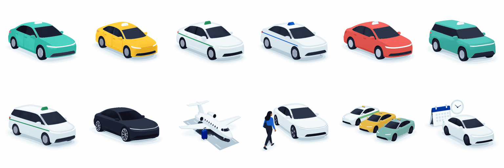

# VNPAY Taxi — Bộ icon 3D (v9)

Bản chuẩn hiện tại: **v9** — style v3 (Uber, 3/4 nhìn từ trên xuống, matte, gọn) + bảng màu lạnh theo ref SVG.

- Figma: [[SDK] Vector Graphics → VNPAY Taxi · Asset v7](https://www.figma.com/design/drYqcpUjIPAWKYZVcZns8k/?node-id=2003-288) — hàng cuối "v9" (node 2045:288–2045:300)
- File: `assets/icons/v9/` — PNG 512×512, nền trắng (RGB, chưa tách nền)
- Ảnh xem nhanh: `assets/icons/v9-preview.png`

## Danh sách

| File | Nội dung | Figma node |
|---|---|---|
| `taxi-v9-gs4.png` | Xe 4 chỗ — xanh ngọc | 2045:289 |
| `taxi-v9-be4.png` | Xe 4 chỗ — vàng | 2045:290 |
| `taxi-v9-ml4.png` | Xe 4 chỗ — trắng sọc xanh lá | 2045:291 |
| `taxi-v9-vns.png` | Xe 4 chỗ — trắng sọc xanh dương | 2045:292 |
| `taxi-v9-g7.png` | Xe 4 chỗ — đỏ | 2045:293 |
| `taxi-v9-gs7.png` | Xe 7 chỗ — xanh ngọc | 2045:294 |
| `taxi-v9-ml7.png` | Xe 7 chỗ — trắng sọc xanh lá | 2045:295 |
| `taxi-v9-lux.png` | Xe sang (đen) | 2045:296 |
| `taxi-v9-air.png` | Dịch vụ: Sân bay | 2045:297 |
| `taxi-v9-for.png` | Dịch vụ: Đặt hộ | 2045:298 |
| `taxi-v9-multi.png` | Dịch vụ: Nhiều hãng | 2045:299 |
| `taxi-v9-sched.png` | Dịch vụ: Hẹn giờ | 2045:300 |

## Quy tắc style (tóm tắt)

- Camera/ánh sáng đồng nhất: 3/4 trên xuống, đầu xe hướng xuống phải.
- Trắng **ngả xanh lạnh** (#F2F7F9 → #D9E6ED → #BDD1DC → #A9BECB), không dùng xám trung tính.
- Kính/lốp/xe đen: navy đậm (#0C0B14, #181E2E, #2B3447), giữ contrast.
- 3 tông mỗi vật liệu + gradient dọc nhẹ trong mặt (dưới tối, trên sáng).
- Lazang xám xanh đồng nhất (#737B8A → #A1ADC2 → #C9D3E0); bóng đổ xanh xám nhạt.
- Đèn trước #6F92DA, đèn hậu #A71D30 — dùng rất ít.

Rule đầy đủ: skill `icon-master` trong repo HST-DS (`.claude/skills/icon-master/SKILL.md`).
